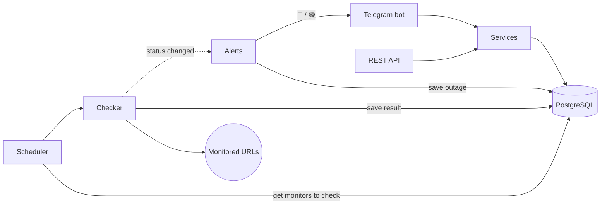

<h1 align="center">Pulse</h1>

<p align="center">
  <b>Uptime monitoring service with a Telegram bot.</b><br>
  Pulse checks HTTP endpoints on a schedule and sends a Telegram alert when one goes down and when it recovers.
</p>

<p align="center">
  
  
  
  
  
  
</p>

---

https://github.com/user-attachments/assets/79d2bc4f-b205-4e6f-955c-ff087008986d

## About

Pulse is an uptime monitoring service controlled through a Telegram bot. There is no website and no password: the Telegram account is the login, and the bot is the interface.

```text
/add https://api.example.com/health My API
```

Pulse then checks the URL every minute (the interval can be set from 30 s to 1 h). When the URL stops responding, the bot sends an alert:

```text
🔴 My API is down
GET https://api.example.com/health
Reason: Timeout after 10000ms
```

And when it recovers:

```text
🟢 My API is up again
GET https://api.example.com/health
Was down for 12m · response: 184 ms
```

`/list` shows the monitors, `/status 1` shows uptime and response times, and `/remove 1` stops monitoring a URL. There is also a REST API with Swagger docs at `/docs`; the bot issues the API key with `/apikey`.

## How it works

- **No false alarms.** A monitor is marked down only after 3 failed checks in a row. Each outage is saved with its start and end time.
- **Can run as several copies.** Each copy takes a different set of monitors from the database, so no monitor is checked twice.
- **Checks and alerts are separate.** When a status changes, the checker sends an event, and a separate module sends the Telegram message.
- **Same logic for bot and API.** The bot and the REST API use the same code underneath.
- **Users only see their own data.** Every request is limited to the user's own monitors, and API keys are stored as hashes.



## Built with

NestJS 12 (ESM, strict TypeScript) · PostgreSQL 18 · Drizzle ORM · grammY · Docker Compose · Bun

## Running locally

Create a bot with [@BotFather](https://t.me/BotFather) and put its token into `.env`:

```bash
cp .env.example .env
docker compose up -d --build
```

This starts Postgres, applies the migrations and runs the app. Then open the bot and send `/start`.

For development without Docker (needs Bun, Node 24 and a local Postgres):

```bash
bun install
bun run db:migrate
bun run start:dev
```

Telegram lets only one process receive updates per bot token, so don't run both setups at once.
